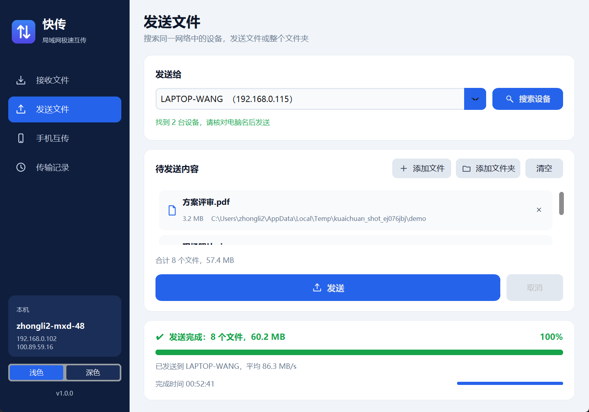
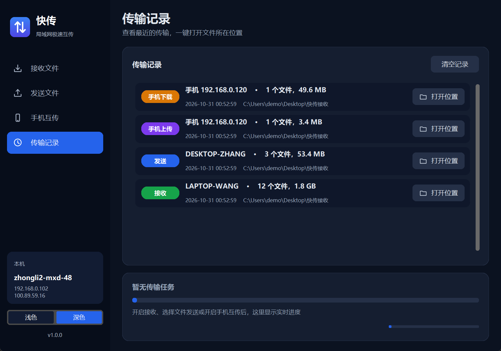

<div align="center">


# 快传 KuaiChuan

**局域网极速互传 —— 电脑与电脑、手机与电脑，一键直传，不经过任何服务器**


[](https://github.com/lizhongv/kuaichuan/releases/latest)

[下载使用](#-快速开始) · [使用指南](#-使用指南) · [常见问题](#-常见问题) · [工作原理](#-工作原理) · [参与开发](#-开发与构建)


</div>

---

## ✨ 功能特性

| | 特性 | 说明 |
|---|---|---|
| 🚀 | **局域网满速** | 点对点直传，网线约 100 MB/s，5GHz Wi-Fi 约 20～100 MB/s；文件大小、数量不限 |
| 🔍 | **自动发现设备** | 一键搜索同网段已开启接收的电脑，显示电脑名与 IP，杜绝发错对象 |
| 📁 | **文件夹整体发送** | 保留原有目录结构，支持中文文件名、空文件 |
| 📱 | **手机扫码互传** | 手机无需安装 App，扫码即可上传照片文件、下载电脑共享文件；安卓、iPhone 通用 |
| 📊 | **清晰的进度与结果** | 总进度、当前文件进度、速度、剩余时间；完成后弹窗告知「发到哪台电脑、保存在哪」 |
| 🕘 | **传输记录** | 自动记录每次传输，一键打开文件所在位置 |
| 🔒 | **安全可靠** | 不联网、不经服务器；手机访问需随机口令；拒绝越界路径；中断自动清理半截文件 |
| 🎨 | **现代界面** | 浅色 / 深色主题，适配 Windows 高分屏缩放 |
| 📦 | **开箱即用** | 单个 exe，双击运行，无需安装 Python 或任何依赖 |

<table>
  <tr>
    <td></td>
    <td></td>
  </tr>
  <tr>
    <td align="center">发送文件：自动发现设备，文件与文件夹混合发送</td>
    <td align="center">手机互传：扫码即用，无需安装 App</td>
  </tr>
  <tr>
    <td></td>
    <td></td>
  </tr>
  <tr>
    <td align="center">传输记录（深色主题）</td>
    <td align="center">接收文件（深色主题）</td>
  </tr>
</table>

## 🚀 快速开始

### 方式一：直接下载 exe（推荐）

1. 在 [Releases](https://github.com/lizhongv/kuaichuan/releases/latest) 页面下载 `KuaiChuan.exe`。
2. 每台需要互传的电脑各放一份，双击运行即可。
3. 首次开启接收或手机互传时，Windows 防火墙会弹窗，请勾选并点击 **允许访问**。

> 系统要求：Windows 10 / 11（64 位）。两台设备需在同一局域网：同一 Wi-Fi、同一路由器、网线直连或连接同一手机热点均可。

### 方式二：从源码运行

```bash
git clone https://github.com/lizhongv/kuaichuan.git
cd kuaichuan
pip install -r requirements.txt
set PYTHONPATH=src          # PowerShell：$env:PYTHONPATH="src"
python -m kuaichuan
```

或以可编辑方式安装后直接使用命令 `kuaichuan`：

```bash
pip install -e .
kuaichuan
```

## 📖 使用指南

### 电脑 → 电脑

| 步骤 | 接收方 | 发送方 |
|---|---|---|
| 1 | 打开「接收文件」，点击 **开启接收** | —— |
| 2 | —— | 打开「发送文件」，点击 **搜索设备**，核对对方电脑名 |
| 3 | —— | **添加文件 / 添加文件夹**，点击 **发送** |
| 4 | 弹窗提示来自谁、保存在哪，可一键打开 | 弹窗提示已发送到哪台电脑、对方保存在哪 |

- 默认保存到桌面的「快传接收」文件夹（兼容 OneDrive 同步桌面），可在「保存位置」修改，程序会记住。
- 搜索不到设备时，可在「发送给」中直接输入对方 IP（对方左下角显示本机 IP）。

### 手机 ↔ 电脑

1. 电脑打开「手机互传」，点击 **开启手机互传**，左侧出现二维码。
2. 手机连接同一 Wi-Fi，用相机或微信扫码打开网页。
3. **手机传电脑**：点「选择文件或照片」，可多选，逐个显示上传进度。
4. **电脑传手机**：把文件放进「共享给手机」文件夹，手机点「刷新列表」后下载。
5. 用完点击 **关闭手机互传**，访问口令随即失效。

## ❓ 常见问题

<details>
<summary><b>搜索不到设备 / 连接超时？</b></summary>

1. 确认对方已点击「开启接收」，状态显示绿色「接收中」。
2. 确认两台设备在同一网络。可在发送方命令行执行 `ping 对方IP` 检查连通性。
3. 公司 Wi-Fi 可能开启了「设备隔离」，会屏蔽设备之间的连接，改用手机热点或网线直连即可。
4. 首次使用时防火墙弹窗未允许：在「Windows 安全中心 → 防火墙 → 允许应用通过防火墙」中勾选快传。
</details>

<details>
<summary><b>显示发送成功，但对方找不到文件？</b></summary>

查看发送成功弹窗中的「对方保存在」路径；或让对方在「传输记录」中点击「打开位置」。
</details>

<details>
<summary><b>手机扫码打不开网页？</b></summary>

电脑可能有多个网卡（VPN、虚拟机等），在二维码下方「网卡」中切换到与手机同网段的 IP（通常为 192.168 开头）后重新扫码。
</details>

<details>
<summary><b>微信里点下载没有反应？</b></summary>

点击右上角「在浏览器中打开」后再下载。
</details>

<details>
<summary><b>速度有多快？文件大小有限制吗？</b></summary>

程序不限速、不限大小，瓶颈在网络：千兆网线约 100 MB/s，5GHz Wi-Fi 约 20～100 MB/s，2.4GHz 或手机热点约 3～15 MB/s。当前版本不支持断点续传，中断后需重新发送。
</details>

<details>
<summary><b>杀毒软件提示风险？</b></summary>

PyInstaller 打包的程序偶尔会被误报。源码完全公开，可自行从源码构建；也可将 exe 加入信任列表。
</details>

## 🔧 工作原理

```
┌──────────── 电脑 A ────────────┐          ┌──────────── 电脑 B ────────────┐
│  发送                          │  UDP 9001 │  接收                          │
│  ① 广播「谁在接收？」──────────┼──────────▶│  回复电脑名                    │
│  ② 连接 ───────────────────────┼─ TCP 9000▶│  握手：报电脑名与保存路径      │
│  ③ 逐个发送 {文件名,大小}+内容 ├──────────▶│  边收边写盘，每个文件回确认    │
│  ④ 结束标记 ───────────────────┼──────────▶│  回执：保存路径与文件数        │
└────────────────────────────────┘          └────────────────────────────────┘

┌──────────── 手机浏览器 ────────┐          ┌──────────── 电脑 ──────────────┐
│  扫码打开网页 ─────────────────┼─ HTTP 9002▶│  内置网页服务（需随机口令）    │
│  上传 / 列表 / 下载            │           │  上传保存目录 · 共享文件夹      │
└────────────────────────────────┘          └────────────────────────────────┘
```

完整协议见 [docs/protocol.md](docs/protocol.md)。

| 端口 | 协议 | 用途 |
|---|---|---|
| 9000 | TCP | 电脑互传 |
| 9001 | UDP | 设备搜索（广播） |
| 9002 | HTTP | 手机互传网页 |

## 🔒 安全说明

- 所有传输只在局域网内点对点进行，不上传任何服务器，不收集任何数据。
- 手机互传地址带有随机口令，每次开启都会变化；关闭后旧地址立即失效。
- 手机端只能访问「共享给手机」文件夹，无法读取电脑上的其他文件。
- 接收端拒绝 `../` 等越界路径，文件只会写入指定的保存目录；同名上传自动改名，不覆盖已有文件。
- 传输中断或取消时，接收端自动删除未收完的文件。
- 局域网内传输未加密，请勿在不可信的公共网络中传输敏感文件。

## 🛠 开发与构建

### 项目结构

```
kuaichuan/
├── src/kuaichuan/
│   ├── __main__.py        程序入口
│   ├── config.py          常量、资源路径、设置与传输记录
│   ├── utils.py           格式化、路径安全、文件展开、本机 IP
│   ├── protocol.py        电脑互传线路协议
│   ├── transfer.py        接收服务、发送任务、设备搜索
│   ├── web.py             手机互传网页服务
│   ├── assets/            手机端网页、应用图标
│   └── ui/                界面：主题、图标、组件、页面、主窗口
├── tests/                 自动化测试（pytest）
├── scripts/               构建、生成图标、生成截图
├── packaging/             PyInstaller 配置与 exe 版本信息
└── docs/                  协议文档与截图
```

### 本地开发

```bash
pip install -r requirements-dev.txt
python -m pytest            # 运行测试
python scripts/screenshots.py   # 重新生成 README 截图（Windows）
```

### 打包 exe

```powershell
powershell -ExecutionPolicy Bypass -File scripts\build.ps1
```

脚本依次执行：安装依赖 → 生成图标 → 运行测试 → PyInstaller 打包，产物为 `dist\KuaiChuan.exe`。

### 发布新版本

1. 同步修改 `src/kuaichuan/__init__.py`、`pyproject.toml`、`packaging/version_info.txt` 中的版本号。
2. 在 `CHANGELOG.md` 中记录变更。
3. 打标签 `vX.Y.Z` 并推送，CI 会自动测试并构建 exe。

## 🗺 路线图

- [ ] 断点续传
- [ ] 拖拽文件到窗口直接发送
- [ ] 传输加密（TLS）
- [ ] macOS / Linux 版本
- [ ] 安卓 / iOS 原生 App，实现手机与手机互传

## 🤝 参与贡献

欢迎提交 Issue 和 Pull Request，详见 [CONTRIBUTING.md](CONTRIBUTING.md)。

## 📄 许可证

本项目基于 [MIT License](LICENSE) 开源，可免费用于个人与商业用途。

第三方依赖：[CustomTkinter](https://github.com/TomSchimansky/CustomTkinter)（MIT）、[Pillow](https://github.com/python-pillow/Pillow)（MIT-CMU）、[segno](https://github.com/heuer/segno)（BSD-3-Clause）。
